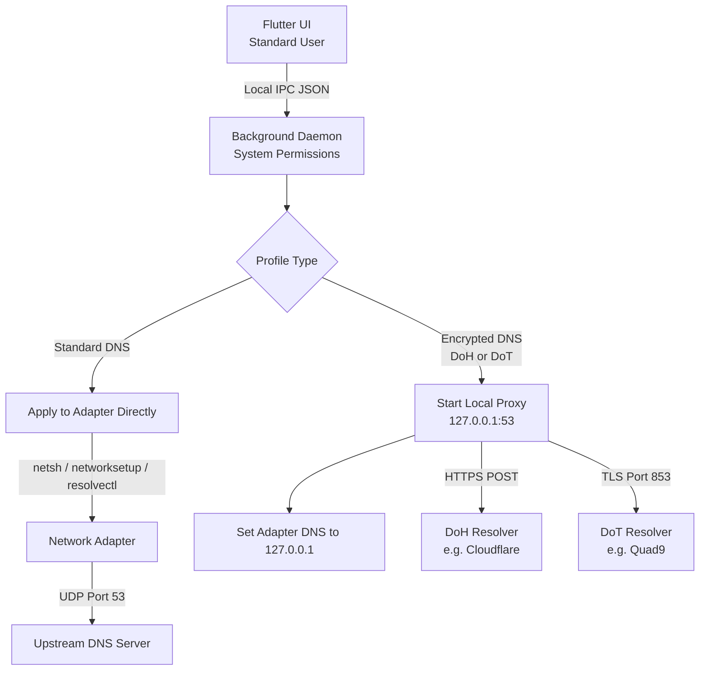
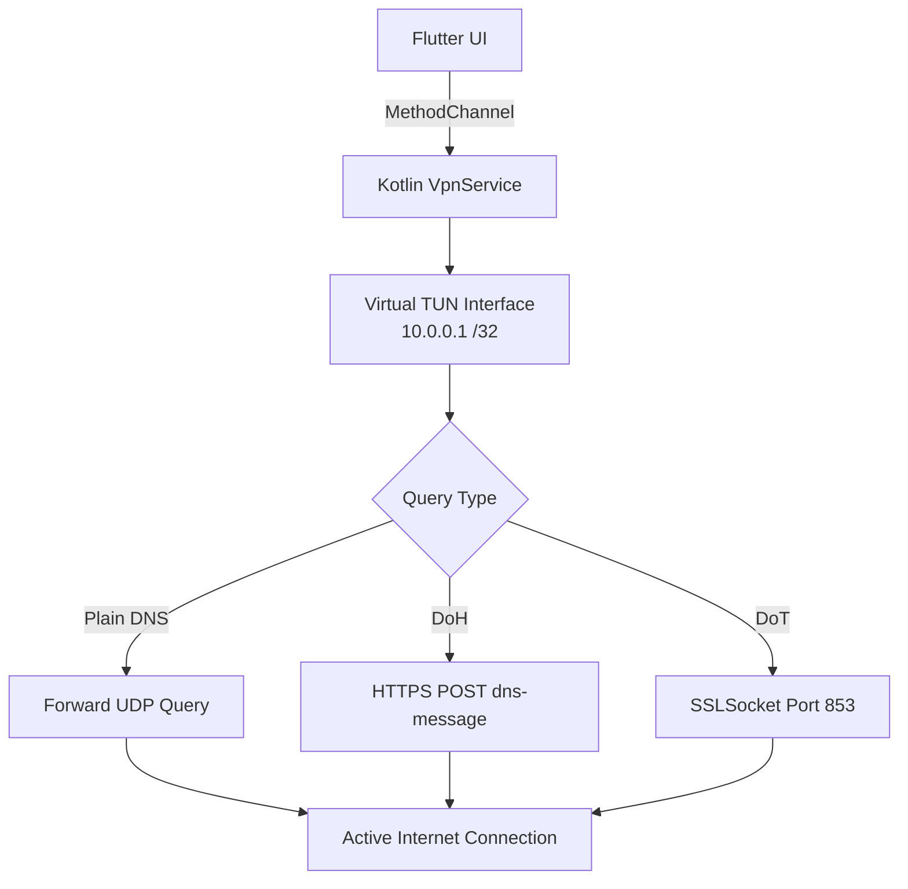
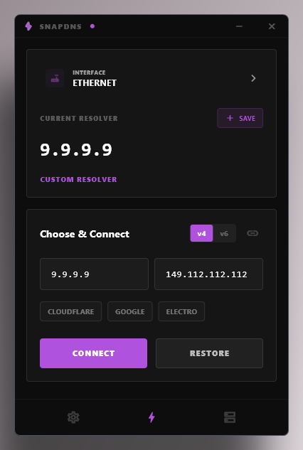
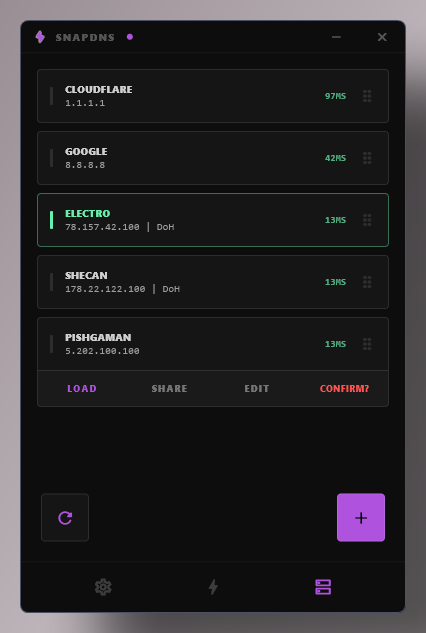
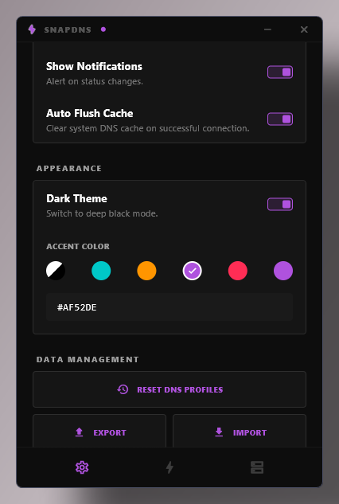

# SnapDNS

<p align="center">
  
  
  
  
  
</p>

<p align="center">
  
</p>

<p align="center">
  A cross-platform DNS manager for Windows, Android, Linux, and macOS. Switch between standard DNS, DNS-over-HTTPS (DoH), and DNS-over-TLS (DoT) without entering administrator credentials on every change.
</p>

---

## Features

- **Standard and encrypted DNS**: Use regular DNS, DNS-over-HTTPS (DoH), or DNS-over-TLS (DoT).
- **Fast one-click switching**: Change DNS without administrator credential prompts on every change.
- **Public DNS catalog**: Search, filter, and test response times across public DNS providers before applying.
- **Custom profiles**: Save and organize custom DNS configurations.
- **Profile backup**: Export and import profiles as JSON files to back up or move between devices.
- **IPv6 leak prevention**: Disable IPv6 on specific network adapters with a single toggle.
- **Adaptive layout**: Choose between a compact portrait view (400x600) and an expanded dual-pane wide layout (800x480).
- **Clipboard auto-fill**: Paste an IP address, domain, or DoH URL to fill entry fields automatically.
- **System tray support**: Minimizes to the system tray, handles single-instance detection, and supports silent launch via `--minimized`.
- **Android support**: Applies DNS via a local device tunnel without routing regular web traffic through an external VPN server, or directly with root permissions.

---

## Architecture

SnapDNS separates the user interface from administrative system tasks.

### Desktop execution flow

The Flutter client runs as an unprivileged user process. It sends JSON commands to a background service running with system permissions over a local pipe (`\\.\pipe\SnapDns_IPC_v1` on Windows, `/var/run/snapdns.sock` on Linux and macOS).



### Direct DNS vs proxy routing
- **Standard DNS**: When using plain IPv4 or IPv6 addresses, the local proxy stays stopped. The background service applies the addresses directly to the active network adapter using operating system tools (`netsh` on Windows, `networksetup` on macOS, `resolvectl` or `NetworkManager` on Linux).
- **Encrypted DNS (DoH and DoT)**: When a profile includes a DoH URL or DoT hostname, the background service starts an internal proxy on `127.0.0.1:53` and sets the network adapter's primary DNS to loopback.
- **Bootstrap resolution**: When the adapter is set to `127.0.0.1`, resolving a domain like `cloudflare-dns.com` would cause a circular lookup loop. The service avoids this by doing a standalone UDP lookup against bootstrap DNS addresses to obtain the endpoint IP before opening the HTTPS or TLS connection.

### Android architecture

On non-rooted Android devices, changing DNS requires a local `VpnService` interface. SnapDNS uses a local split tunnel to capture only DNS traffic, leaving all normal browser and app traffic on your standard internet connection. On rooted systems, DNS can be managed directly.



- **Split tunnel**: A virtual network interface routes only port 53 traffic. Games, browsers, and streaming apps communicate normally over standard network paths.
- **Quick Settings tile**: A native system tile lets users toggle protection on and off from the notification shade.

---

## Screenshots

<p align="center">
  
  
  
</p>

---

## Platform support

| Platform | Format | Service model |
| :--- | :--- | :--- |
| Windows 10/11 | Installer (.exe) or Portable (.zip) | Windows Service (installed once as admin) |
| Linux | Portable (.zip) | Systemd daemon (installed via helper script) |
| macOS | Portable (.zip) | Launchd daemon (installed via helper script) |
| Android 7.0+ | APK (.apk) | System VpnService with Quick Settings tile (or root) |

---

## Installation

### Windows
1. Download `SnapDNS_Windows_x64_Portable.zip` or the installer from Releases.
2. If using the portable version, right-click `install_windows.bat` and select **Run as Administrator** once to register the background service.
3. Open `snapdns.exe`.

### Linux and macOS
1. Extract the portable archive.
2. Run the platform registration script with administrative privileges:
   - Linux: `sudo ./install_linux.sh`
   - macOS: `sudo ./install_mac.command`
3. Launch `snapdns`.

### Android
1. Install the APK.
2. Select a profile, tap Connect, and confirm the system VPN prompt.

---

## Building from source

### 1. Build the background service
```bash
dotnet publish SnapDns_Service/SnapDns.Service.csproj -c Release -r win-x64 --self-contained true
```

### 2. Build the Flutter user interface
```bash
cd SnapDns_UI
flutter pub get
flutter build windows --release
```

---

## Troubleshooting

- **Service Offline on Windows**: Right-click `install_windows.bat` in your SnapDNS folder and select **Run as Administrator** to re-register the background system service.
- **DNS not changing on macOS or Linux**: Ensure you ran the platform installation script (`install_linux.sh` or `install_mac.command`) with `sudo`.

---

## License

This project is licensed under the **GNU General Public License v3.0 (GPL-3.0)**. See the [LICENSE](LICENSE) file for details.
